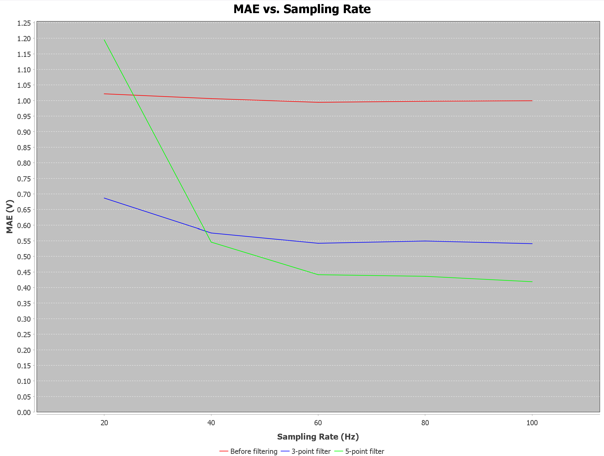
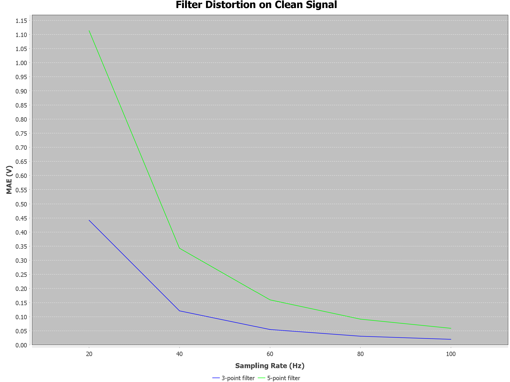

# Signal Processing Benchmark

A Java-based signal processing project that examines the performance of moving-average filters under noisy signal conditions.

## About the Project

The program generates sine-wave signals, adds random noise, and compares the results of 3-point and 5-point moving-average filters.

Filter performance is evaluated using Mean Absolute Error (MAE) across different sampling rates. The project also examines the distortion introduced by filtering a clean signal.

## Features

- Generation of sine-wave signals with configurable amplitude and frequency
- Addition of uniform random noise
- Implementation of 3-point and 5-point moving-average filters
- MAE calculation for comparing filtered signals with a reference signal
- Evaluation across multiple sampling rates
- Visualization of results using line charts

## Tools and Libraries

- Java 21
- Maven
- JFreeChart
- JUnit


## Project Structure

```text
Signal Processing Benchmark/
├── src/
│   ├── main/java/
│   │   └── Main.java
│   └── test/java/
│       └── MainTest.java
├── images/
│   ├── filter-distortion.png
│   └── mae-vs-sampling-rate.png
├── pom.xml
├── README.md
└── .gitignore
```

- **Main.java** — generates signals, applies moving-average filters, calculates MAE, and creates charts.
- **MainTest.java** — contains unit tests for key parts of the implementation.
- **pom.xml** — manages Maven dependencies and build configuration.
- **images/** — stores the experiment result charts displayed in this README.
- **.gitignore** — specifies files and directories that Git should ignore.

## Experiment Settings

| Parameter | Value |
|---|---|
| Signal amplitude | 5.0 V |
| Signal frequency | 2.0 Hz |
| Noise level | 2.0 |
| Random seed | 18 |
| Sampling rates | 20, 40, 60, 80, 100 Hz |
| Signal duration | 2 seconds |
| Runs per sampling rate | 100 |

## Evaluation Method

The program calculates the Mean Absolute Error (MAE) between the noisy signal and the original clean signal. It then calculates the error after applying each filter.

The experiment is repeated 100 times for each sampling rate, and the average error is used for comparison.

The program also applies both filters to the clean signal to measure the changes introduced by filtering without added noise.

## Results and Visualization

The program generates two line charts:

- **MAE vs. Sampling Rate** — compares the error before filtering with the error after applying each filter.
- **Filter Distortion on Clean Signal** — compares the changes introduced by both filters when applied to a clean signal.

### MAE vs. Sampling Rate



### Filter Distortion on Clean Signal



## Key Findings

- The 3-point moving-average filter reduced the average MAE by approximately 31%–46% across the tested sampling rates.
- At 20 Hz, the 5-point filter produced a higher MAE than the original noisy signal. At sampling rates of 40 Hz and above, it outperformed the 3-point filter in terms of MAE.
- The lowest average MAE achieved by the 5-point filter was approximately 0.421 V, at a sampling rate of 100 Hz.
- When applied to a clean signal, the 5-point filter introduced greater distortion than the 3-point filter at every tested sampling rate.

These results highlight the balance between noise reduction and signal distortion. They also demonstrate that the effectiveness of a moving-average filter depends on the sampling rate and the characteristics of the signal being processed.

## Running the Project

1. Open the project in IntelliJ IDEA.
2. Ensure Java 21 is configured and Maven dependencies are loaded.
3. Run the `Main` class.
4. Review the results printed in the console and the generated charts.

## Possible Extensions

- Evaluate additional filtering methods.
- Compare the filters under different noise levels.
- Expand unit tests to cover filter behavior and edge cases.